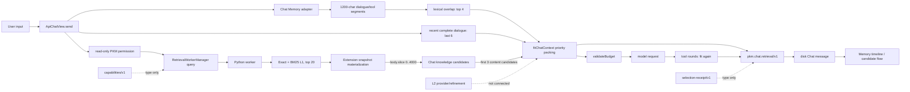
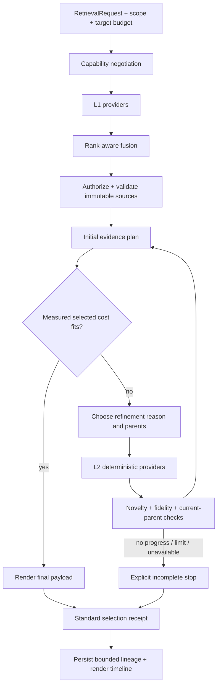

# PKM Retrieval 独立研究与实施设计

记录时间：2026-10-10。研究基线：3.2.19。

本报告响应 [专项研究任务](./pkm-retrieval-research-task.md)，不表示已实施下述新机制。
结论来自本地代码、合成测试 payload 和公开文献；没有向外部服务发送 PKM corpus、
Chat、query 或代码，没有下载模型、训练、启用遥测或调用付费模型。

## 结论

当前最大缺口不是 L1 worker 能否返回候选，而是 consumer 侧缺少完整的
**materialize -> measured selection -> L2 refinement -> reselection -> final receipt**
闭环。现有系统已经具备可用的 lexical L1、Chat-owned Memory 候选、每轮预算排除、
超时/取消隔离和 UI timeline，但标准中的 L2、capabilities negotiation、actual serving
lineage 和通用 final selection receipt 尚未接入 Chat。

优先方案不是立即替换 BM25 或引入远端 embedding，而是：

1. 先修复 L1 materialization 合同，停止在 adapter 内静默 `slice(0, 4000)`；
2. 建立 consumer planner 和确定性、结构感知的 L2 provider；
3. 用 immutable source/range、actual serving identity 和最终 payload manifest 闭合回执；
4. 建立本地离线质量集后，再以可替换 route 比较 BM25、sparse/dense、reranker；
5. 学习型 route 仅在实测增益、资源上限、隐私和回滚门均通过后准入。

## 1. 研究方法与实测基线

### 1.1 检查范围

检查了通用 contracts、TypeScript/Python worker、Chat Memory、Chat controller、
上下文预算、持久回执、Webview 和 M01-M18 权威测试矩阵。重点入口：

- [retrieval-contracts.ts](../../src/retrieval/retrieval-contracts.ts)
- [retrieval-provider.ts](../../src/retrieval/retrieval-provider.ts)
- [retrieval-worker.ts](../../src/retrieval/retrieval-worker.ts)
- [retrieval_worker.py](../../resources/retrieval_worker.py)
- [chat-memory.ts](../../src/chat/chat-memory.ts)
- [chat-context.ts](../../src/chat/chat-context.ts)
- [chat-retrieval.ts](../../src/chat/chat-retrieval.ts)
- [api-chat-view.ts](../../src/chat/api-chat-view.ts)
- [api-chat.js](../../src/webview/api-chat.js)
- [test-chat-context-contracts.js](../../tests/test-chat-context-contracts.js)

### 1.2 可复现命令与结果

2026-10-10 在本地依次执行：

| 命令 | 结果 | 解释边界 |
| --- | --- | --- |
| `npm run build` | exit 0，8.32 s | 只证明构建通过 |
| `node --test tests/test-chat-context-contracts.js` | 26 pass，0 fail，18 TODO，5.60 s | controller + disk + loopback HTTP；不是 installed Host E2E |
| `node tests/test-api-chat.js` | exit 0，9.98 s | 既有 Chat 回归 |
| `node tests/test-retrieval-contracts.js` | exit 0，0.04 s | contracts/guard 回归 |
| `python tests/test-retrieval-serving-worker.py` | 1 pass，3.87 s | serving fallback 隔离；不是最终 payload E2E |

18 个 TODO 是未验收机制，不是 skip 后的通过。当前可执行合成基线仍证明：

- 128,941 字符历史中，query `docker-beta QPS concurrency=32 version=v2`
  可选中 273 字符目标 tool evidence；
- 8K window 的 loopback HTTP payload 包含目标证据，不包含无关 tool output；
- History 保持开启，原始磁盘证据不变；
- 必需输入超预算时在 model dispatch 前失败；
- hung retriever 在约 5 秒 deadline 后隔离，caller cancellation 不转成 fallback success。

这些是上下文正确性样本，不是线上 retrieval quality 结果。

## 2. 当前实际调用链

### 2.1 Chat-owned Memory 与 History

`chatMemorySegments` 把完整 dialogue 和已结束 tool result 按固定 1,200 characters
无 overlap 切分。ID 包含 message、source kind、SHA-256 revision 和 chunk index，range
为原 source 的 character half-open range。tool header 包含 name、call ID、status 和
arguments，因此失败与成功 evidence 可区分。

`retrieveChatMemory` 使用 query term 的 substring overlap，分数为命中 term 长度之和；
保留不低于最高分 60% 的最多 4 段。`recentChatDialogue` 另取最后 6 条、每条不超过
1,200 characters 的 complete dialogue。两者均受 `includeHistory` 控制。

Context priority 当前为：匹配 Memory `100 + score`，L1 knowledge `50 - rank`，recent
dialogue `0..5`。这是固定 greedy packing，不是 coverage、dependency 或 condition-aware
planner。

### 2.2 PKM L1 provider/worker

Chat 发出 `pkm.retrieval.query/v1`：`l1-source`、`topK=20`、`route=lexical`、
`latest-ready`、5 秒 deadline。TypeScript worker 等待 generation，Python worker 使用
Exact + academic BM25，并可在满足限定 scope 时走已准入的 Skill serving path。

Python result 已包含 `solution`、`skill_serving.used/release_id/fallback_reason`、
generation、corpus revision、route components 和 diagnostics。然而 extension 把 hit
转换为 Chat candidate 时没有映射 `serving`，Chat receipt 因而无法证明实际使用的是
learned package 还是 Exact/BM25 fallback。

### 2.3 Materialization 与选择

extension 通过当前 snapshot 对 `sourceId + sourceRevision + visibility` 再验证，然后把
`document.body.slice(0, 4000)` 放入 candidate。Chat controller 只处理排名最前的 3 个带
content 候选，并规定 `content.length > 4000` 时不插入 request、改为标记需要 L2。

这两个边界互相冲突：生产 worker-to-Chat adapter 已将内容截为最多 4,000 characters，
所以 controller 虽有 `>4000` 检查，但从该 adapter 到达时不能触发。结果是：

- 长 L1 source 被静默前缀截断；
- candidate 没有 `truncated/materialization` 状态；
- answer 位于 4,000 characters 后时无法触发 L2；
- 合成测试可覆盖“oversized candidate 被拒绝”，但没有覆盖真实 adapter 的提前截断。

这是当前最具体、最优先的根因。

`fitChatContext` 先计算 mandatory system/current input/pinned/live tool pairs；若 mandatory
超预算则明确失败。自动引用按 priority 降序逐个装入，装不下即排除。每个 tool round
前重新执行该函数，随后 `validateBudget`，所以已有 M01/M11 的部分基础，但没有超预算
后的 L2/refinement 或 evidence-condition 规划。

### 2.4 Receipt 与 UI

当前持久化的是 Chat-specific `pkm.chat.retrieval/v1` 及
`pkm.chat.retrieval-activity/v1`。timeline 区分 memory/knowledge recall attempts、每轮
sent context、输入估算和最多 32 轮记录；UI 可查看 selected/excluded candidate。

它不是标准 `pkm.retrieval.selection-receipt/v1`：缺少 request/consumer/target identity、
serving identities、统一 budget、incomplete 和最终 materialization manifest。当前 receipt
还重复持久化 raw query，而标准默认 durable receipt 不应复制 raw query/body。

## 3. 根因分层

| 症状 | 根因类别 | 当前证据 | 不能误判为 |
| --- | --- | --- | --- |
| query 找不到语义相关旧证据 | recall/ranking | substring overlap、最多 4 段 | budget 问题 |
| 大量相似小段挤占候选 | duplicate/granularity | 固定 1,200 char，无 overlap/dedup/parent coverage | model window 太小 |
| 长 Note/Recipe 后半段永远不可见 | materialization/L2 | adapter 提前 `slice(0,4000)` | BM25 排序失败 |
| 相关候选被排除 | context selection | greedy priority packing 与 mandatory cost | provider recall 失败 |
| learned route 实际 fallback 不可见 | lineage/protocol migration | worker 有字段，Chat mapping 丢失 | relevance degradation |
| source 更新后旧 candidate | stale identity | L1 current snapshot check 已有；L2 parent/hash 未接入 | 普通 no-match |
| recent/history 噪声 | recency/granularity | last 6 与 query Memory 是两条固定路径 | 应关闭 History |
| 必需 context 自身过大 | mandatory budget | 明确 pre-send error | 自动 evidence 应被删除 |
| worker throw/hang | runtime | guard degraded/unavailable、deadline/cancel | retrieval quality 差 |

建议离线 case 至少记录：query、授权 scope、corpus revision、候选 immutable identity、
per-route rank、materialized ranges、选择/排除原因、budget、最终 payload manifest 和 stop
reason。答案文本不作为 relevance oracle。

## 4. 候选方案比较

公开证据只用于选择实验方向：BEIR 在 18 个异构数据集上显示 BM25 是稳健 baseline，
late interaction/reranking 平均质量较好但计算成本高；DPR 在其 open-domain QA 设置中
报告 dense top-20 accuracy 超过 BM25，但不能外推到私人 PKM corpus；SPLADE 保留 inverted
index 与 exact-term 特性并学习 expansion；ColBERT 通过预计算 document token
representations 降低 cross-encoder query 成本。RRF 使用 rank 而非不可比分数进行融合。
Lost in the Middle 表明扩大上下文并不能保证模型稳定利用中部 evidence。Late Chunking
说明独立短 chunk embedding 会丢失周边上下文，但它依赖 long-context embedding，不能
替代确定性 range 与结构保真。

| 方案 | 适合角色 | 质量假设 | 延迟/资源 | 隐私与部署 | 本项目建议 |
| --- | --- | --- | --- | --- | --- |
| 当前 substring rule | Chat Memory safety baseline | exact term 可解释；同义/改写弱 | 极低 CPU/RAM，无索引 | 纯本地、零模型 | 保留为 fallback，不作为终态 |
| BM25 | L1 与 L2 lexical baseline | rare ID、命令、版本、单位稳健 | inverted index；当前 worker 已有 | 纯本地、升级简单 | 第一基线，先补 passage index |
| Learned sparse/SPLADE | 可选 L1/L2 route | expansion 改善词汇错配 | 模型推理与更大 sparse index | 需本地 artifact 准入 | 有 gold set 后实验 |
| Dense dual encoder | 可选 semantic recall | paraphrase/概念 recall 可能提高 | embedding index + model RAM | 模型来源/许可/下载需批准 | 不默认启用；按语言/类型切片评估 |
| ColBERT/late interaction | top-N retrieval 或 rerank | token-level matching、细粒度较强 | index 大于 single-vector；高于 BM25 | 本地 package 生命周期更复杂 | 仅在 quality/cost gate 后试验 |
| Cross-encoder reranker | BM25/dense shortlist rerank | 候选内 precision 潜力高 | 每 query-candidate 推理，成本最高 | 本地模型准入或外发风险 | 仅 rerank 小 K，不做第一阶段 |
| RRF/bounded round-robin | heterogeneous fusion | 避免直接混排 raw scores | 很低 | 可解释、无训练 | 默认 fusion baseline |
| 结构化 splitter | L2 projection | 表格/JSON/code/Markdown 保真 | build-time CPU，低 query cost | 纯本地、确定性 | P1 必做 |
| 抽取式 L2 selection | L2 materialization | 只发送相关 ranges，保留原文 | lexical 低；learned route 可插拔 | 不生成新事实 | P1 必做 |
| LLM rewrite/compression | 单独 fallback capability | 可缩短但会改写/遗漏条件 | 高延迟/成本 | 需单独批准，可能外发 | 默认关闭，不是 refinement 同义词 |

### 4.1 已有相邻本地测量及其限制

已有 Adaptive Skill Retrieval 实验可为路线成本和实验设计提供相邻证据，但 corpus、query
和 relevance label 与 Chat Memory/Recipe 不同，**不能作为本任务的 winner 或 promotion
evidence**：

| 本地实验 | 实测结果 | 可支持的判断 | 不可外推的判断 |
| --- | --- | --- | --- |
| Typed mixed PKM，450 docs，Exact+BM25 | index 165.2 ms；6 个 query 为 3.32-20.34 ms | lexical persistent worker 在该规模可运行 | Memory relevance、p95/p99、并发能力 |
| Deterministic scale probe，10,220 docs | index 3.045 s；5-run means 58.38-277.98 ms | 不应 per-request rebuild；需要 persistent index | live-corpus tail latency |
| Human-gold skill pilot，8 validation | BM25 Recall@5 0.375/MRR 0.292；GTE+reranker 1.000/0.817 | learned route 值得在更大 gold set 重测 | production gain；样本只有 8 |
| Search-call pilot，15 validation | BM25 Recall@5 0.656/MRR 0.622 | fuzzy skill query 上 lexical 是有意义 control | Chat Memory、Recipe 或 no-match 质量 |
| E5 projection pilot | 384d index 235,008 B；128d 78,336 B，二者该小集 Recall/MRR 相同 | index-size trade-off 可实测 | 128d 普遍无损；该集很小 |

原始记录：[Typed Corpus Validation](../../../../notes/Research/Adaptive%20Skill%20Retrieval/PKM%20Typed%20Corpus%20Validation%20%E2%80%94%200.3.0.dev2026091601.md)、
[Logical Paths Benchmark](../../../../notes/Research/Adaptive%20Skill%20Retrieval/All%20Logical%20Paths%20Measured%20Benchmark%202026-09-18.md)、
[Search-Call Pilot](../../../../notes/Research/Adaptive%20Skill%20Retrieval/Search-Call%20Dataset%20Pilot%20Experiments%202026-09-18.md)。

上述 latency 没有统一 cold/warm、p50/p95/p99 或并发协议，不能用于 route admission。
本报告因此只给定性资源排序和下一轮测量字段，不给未经测量的 PKM Chat 数值阈值。

文献：

- Robertson and Zaragoza, [The Probabilistic Relevance Framework: BM25 and Beyond](https://doi.org/10.1561/1500000019), 2009.
- Cormack, Clarke and Buettcher, [Reciprocal Rank Fusion](https://doi.org/10.1145/1571941.1572114), 2009.
- Karpukhin et al., [Dense Passage Retrieval](https://arxiv.org/abs/2004.04906), 2020.
- Khattab and Zaharia, [ColBERT](https://arxiv.org/abs/2004.12832), 2020.
- Thakur et al., [BEIR](https://arxiv.org/abs/2104.08663), 2021.
- Formal et al., [SPLADE v2](https://arxiv.org/abs/2109.10086), 2021.
- Liu et al., [Lost in the Middle](https://arxiv.org/abs/2307.03172), 2023.
- Guenther et al., [Late Chunking](https://arxiv.org/abs/2409.04701), 2024/2025 revision.

## 5. 推荐架构

### 5.1 Provider 层

- `L1SourceProvider`: 返回 source identity、rank、score semantics、serving identity，默认不带
  整个 body。
- `SourceResolver`: 由 consumer 在授权后按 exact revision/hash 读取 immutable blob；读取时
  发生版本变化则拒绝，不使用“最新内容”替代。
- `L2PassageProvider`: 输入 parent identities、query、结构类型和预算；输出带 parent ID、
  parent revision/hash、splitter version、range 和 content hash 的 children。
- Memory/tool evidence 与 corpus passage 共用 candidate/receipt contract，但保持各自存储
  owner 和 permission adapter。

L1、L2 必须分别 capabilities negotiation，可以独立升级或 fallback。query 的 `level`
必须穿过 TypeScript worker 到 Python worker；当前只存在于 contract，未进入 `/search`
payload。

### 5.2 Deterministic L2

第一版按 source kind 选择 splitter：

- Markdown/prose：heading -> paragraph -> sentence boundary，必要时 bounded overlap；
- JSON：先完整 parse，按 object/array subtree 投影，携带 JSON Pointer 和 parent range；
- table/CSV：header 与 selected rows 组成一个 evidence unit，条件列不得分离；
- code：language parser 可用时按 symbol/block，否则按 line boundary；
- tool result：call metadata/status 与 result range 绑定，不把失败输出改写成成功事实；
- unknown text：只在 Unicode/line/sentence boundary 切分，不删除词、否定、单位或 clause。

child ID 建议为：

`sha256(parentId | parentRevision | parentContentHash | splitterId | splitterVersion | unit | start | end)`。

原始 blob 不变；projection cache 可重建。结构 parse 失败必须降级为 unknown-text splitter，
并记录 fidelity warning，不能把 malformed JSON fragment 声称为完整 JSON。

### 5.3 Planner 与停止条件

Planner 使用 evidence unit，而不是直接操作 rendered message。每轮顺序固定：

1. 计算 mandatory cost 和真正可用预算 `B`；
2. retrieval/fusion 后做 initial selection；
3. materialize 并测量所选 evidence，不测整个 corpus；
4. `cost <= B` 立即发送，不启动 refinement；
5. `cost > B` 才选择 oversized/low-density parents 做 L2；
6. 验证 children current、结构保真和 novelty 后 reselection；
7. fit、no-progress、deadline、cancel、attempt/candidate/byte/CPU limit 任一成立即停止；
8. 根据实际 rendered payload 生成 receipt，再 dispatch。

No-progress fingerprint 至少包含 selected immutable IDs/ranges、unresolved needs、query/scope、
route 和 refinement policy。连续一轮无新 child、无 cost reduction、无 coverage 增加即停止；
不得重复同一请求直到 deadline。

### 5.4 Selection 与 fusion

先做 per-method ranking，再以 bounded round-robin 或 RRF 合并，不比较 BM25、cosine、
distance 和 probability 原始值。之后 planner 优化：

- query/condition coverage；
- source diversity 与必要的多来源 comparison；
- immutable evidence dependencies，例如 table header、metric、unit、test conditions；
- token cost；
- recency 只作为显式 component，不成为强制 replay。

初版无需求解复杂 knapsack；可用 deterministic greedy marginal coverage/cost，但必须记录
每个 selection reason 和 unmet condition，且 tie-break 稳定。

### 5.5 Storage、隐私与恢复

- source blobs 以 content hash 寻址，manifest 原子指向 committed generation；
- index 和 projection 只是可重建派生物，不是证据唯一副本；
- 发布顺序：write/fsync blob -> build projection/index -> write/fsync generation manifest ->
  atomic switch；
- recovery 只接受 manifest 可达且 hash 匹配的 blob；dangling reference 显式 missing；
- receipt 不复制 body，默认不复制 raw query，仅保存 query digest/reference、counts、timings、
  immutable evidence 和 serving identities；
- raw query、training event、click/feedback、export 和 serving update 分别 opt-in；revoke 后不得
  继续生成新训练事件。未选择候选不能自动作为 negative。

## 6. 标准与实现差距

| 标准项 | 当前状态 | 需要的迁移 |
| --- | --- | --- |
| Query/result/index schemas | 已实现并验证 | 保持兼容；传递 `level` 与实际 serving |
| Provider capabilities | interface/validator only | worker 暴露标准 endpoint；consumer 先协商 |
| L1 immutable identity | 大部分实现 | materialize 时 exact hash/revision；禁止静默 slice |
| L2 parent/range contract | validator only | 新 L2 provider、stable child IDs、splitter version |
| Scope/permission | Chat permission +部分 filters | capabilityId 变为可执行授权，不只是字符串 |
| Generation/deadline/cancel | generation/deadline 较完整 | refinement 每步继承同一 absolute deadline/cancel |
| Score semantics/fusion | fields 存在；Chat priority 隐式 | 显式 per-method fusion policy 与 components |
| Actual serving/fallback | Python 有，Chat 丢失 | 映射到每个 candidate 和 final receipt |
| Final selection receipt | Chat-specific receipt | payload 渲染后生成标准 receipt；旧 UI adapter 兼容 |
| Durable privacy | receipt 重复 raw query | query reference/digest；feedback 单独 consent |
| Source/blob recovery | snapshot/manifest 部分实现 | immutable blobs + atomic generation recovery |
| L1/L2 independent replacement | L1 worker 可替换；L2 无 | 分离 provider capability/version/release |

标准本身还应补充：

1. materialization resolver contract 与 `truncated` 禁止规则；
2. splitter/projection identity、结构 dependency 和 fidelity warning；
3. planner attempt/stop event schema 及 absolute resource budgets；
4. query reference/digest，避免 selection receipt 必须复制 raw query；
5. final payload manifest 的 canonical digest 算法；
6. capabilities cache 的 TTL/upgrade invalidation 和 mid-flight provider change 处理；
7. blob/index/manifest commit 与恢复协议。

## 7. M01-M18 覆盖设计

“部分基础”表示已有邻近行为，但权威 TODO 不能删除。

| ID | 当前证据 | 生产机制与验收 |
| --- | --- | --- |
| M01 | exact/one-over optional fit unit test；部分基础 | counting adapter + planner；`B-1/B` 断言 0 refinement/0 rewrite/1 send |
| M02 | 无 refinement | initial selection 后 measured `B+1` 才调用 L2；断言调用顺序和 0 premature send |
| M03 | 无 | first children fit 后 stop；1 refinement、1 reselection、1 answer request |
| M04 | 无 | novelty fingerprint；重复-only result 产生 `no-progress`，不再调用 provider |
| M05 | retrieval deadline 有，planner limits 无 | injected clock/counters 覆盖 attempt/time/candidate/bytes/CPU，每项卡在下一操作前 |
| M06 | 无结构 splitter | JSON/table fixtures 验证 parse、pointer/range、header/entity/metric/unit/conditions |
| M07 | 原 evidence 不改；无 unknown splitter | Unicode boundary extraction；逐字对应 parent range，禁止 heuristic deletion |
| M08 | 当前无 LLM refinement | separate capability + approval；未批准时 0 model/download call 和 explicit unresolved |
| M09 | L1 snapshot current check；Memory revision ID | retrieve 后 mutate source，materialize 必须 stale reject；projection cache invalidated |
| M10 | Memory range/revision 部分基础 | 两次 projection ID/range 完全一致；parent/splitter version 变化产生新 identity |
| M11 | `beforeRound` 每轮 fit；live tool pairs mandatory | planner event 每轮；增长的 tool results 不 orphan/replay，outcome status 保留 |
| M12 | fit 失败发生在 dequeue 前；部分基础 | steering plan 失败仍 queued，成功仅消费一次；持久化/重启重复投递测试 |
| M13 | 共用 send path；scope 未完整验收 | retry/child target model/scope planner；禁止 sender history/image/tool side-effect replay |
| M14 | round receipt 与 loopback payload 有基础 | refinement 后以 rendered payload 反建 manifest；IDs/ranges/count/digest 逐项相等 |
| M15 | Python result 有 fallback；Chat 丢失 | requested/served/package/version/fallback 全链路；强制 fallback fixture 校验 UI/receipt |
| M16 | 无通用 feedback path 不能等同验收 | opt-in off/revoked 下 0 raw capture/event/upload/weight update；正常 answer 不受阻 |
| M17 | atomic snapshot 有部分基础 | blob/index/manifest 每个 crash point；恢复或 explicit missing，不接受 dangling evidence |
| M18 | 现有 controller/browser 不是 installed E2E | 安装 VSIX，真实 Host + browser + worker，验证 UI trigger、reload/cancel/retry/steer |

## 8. 分阶段实施任务

### P0：关闭信息丢失和 lineage 缺口

1. 移除 adapter 的 body prefix materialization，改为 metadata-only L1 candidate + exact
   `SourceResolver`。
2. 将 worker `solution/skill_serving` 映射为标准 `serving`；新增 forced-fallback integration
   test。
3. worker 暴露 `capabilities/v1`，Chat 协商 schema/level/routes/limits。
4. 标准 receipt adapter 与 payload manifest digest；旧 `pkm.chat.retrieval/v1` UI 保持兼容。
5. 新增真实 worker -> resolver -> planner -> loopback payload test，覆盖 stale revision。

退出门：无静默 truncation；M09、M14、M15 的 production-hook 正/负测试可执行通过；
现有 26 tests 无回归。这里是 protocol/mechanism gate，不是 retrieval quality promotion。

### P1：确定性 L2 与 bounded planner

1. 实现 prose/Markdown、JSON、table、code/tool、unknown splitters 及 stable projection cache。
2. 实现 measured selection/refinement/reselection state machine 和 stop events。
3. 将 Memory 固定 1,200-char path 迁移为同一 L2 contract，保留 legacy lazy migration。
4. 每轮 tool/steering/retry/delegation 使用同一 planner，保留 target scope。
5. UI 展示 parent -> child、before/after cost、stop reason 和 unresolved needs。

进入条件：P0 capabilities/materialization/receipt integration 已通过；先用 representative
fixture 测量 splitter build/query CPU、RSS、projection bytes 和 planner latency baseline。

退出门：M01-M14（除尚依赖 store 的项目）全部 executable；JSON/table/unknown prose fidelity
fixtures 逐字 range 可验证；无额外 answer call。这仍是 correctness gate，质量比较留在 P3。

### P2：存储、恢复与隐私

1. content-addressed immutable blobs、generation manifest 和 crash-safe publish/recovery。
2. bounded projection/index rebuild、corrupt/disk-full/source deletion/multi-window tests。
3. feedback consent/retention/delete/export contract；query digest/reference 迁移。

退出门：M16-M17 通过；任一 crash point 后 evidence 可解析或明确 missing；opt-out 零训练事件。

### P3：质量实验与可替换 learned routes

1. 用户明确批准数据范围、保留期和允许的 label 来源后，构建 local gold set，按 source
  type、intent、language、exact/fuzzy、no-match 分层；没有批准只用 synthetic fixtures。
2. 固定 corpus revision/split，依次测 substring、BM25 L1/L2、RRF、learned sparse、dense、
   late interaction/reranker；遵守 OFAT。
3. 报告 Recall@k、MRR、nDCG@k、evidence-condition coverage、duplicate rate、no-match FPR、
   stale rejection、index bytes、cold/warm p50/p95/p99、CPU/RAM。
4. solution package 不含私人 corpus；admission 绑定 artifact integrity、corpus compatibility、
   quality/resource/non-regression gates。

退出门在首轮实测后定数值，不预先编造改善幅度。最低原则：exact slice 不回归，所有隐私/
协议/预算 hard gates 通过，learned route 相对 BM25 的置信区间和资源代价均公开。若 learned
route 未显著优于 BM25 + deterministic L2、置信区间跨越 non-regression margin，或资源超限，
则不生成 promotion manifest，默认 route 保持 BM25；实验 package 可删除且不改变 corpus/index
generation。每个实验一次只改变一个 factor，P0/P1 correctness 变化不与 learned-route 质量
比较合并成同一 variant。

### P4：真实安装验收与渐进发布

1. 构建并安装隔离 VSIX 到测试 Extension Host；使用 synthetic corpus/history。
2. browser 驱动验证 History on、large history、L2 trigger、receipt、reload、cancel、retry、
   steering 和 forced fallback。
3. fault injection：worker crash、stale generation、corrupt projection、deadline、disk-full。
4. 先 shadow/off-by-default，再 opt-in；保留一键回到 BM25 + deterministic L2 的 rollback。

退出门：M18 通过，M01-M18 无 TODO，所有现有回归通过；installed build、worker/package/
generation identity 和测试 artifacts 可复现。

## 9. 验收指标与判定

### 9.1 Hard gates

- payload tokens 不超过 target input budget；mandatory over-budget 时 0 model dispatch；
- receipt selected IDs/ranges/count/digest 与实际 payload 完全一致；
- stale/unauthorized/orphan L2 evidence 0 注入；
- JSON/table/code fidelity fixtures 0 结构破坏，数值/单位/否定/条件逐字可追溯；
- cancellation 后 0 completed receipt；fallback actual identity 100% 记录；
- feedback off/revoked 时 0 training/raw-query/weight-update event；
- crash recovery 无 dangling evidence 被当作有效；
- 全部 M01-M18 正/负触发、顺序、call count、boundary 和 stop assertions 通过。

### 9.2 Quality 与资源 baseline

先记录当前 substring/BM25 的分层指标和 bootstrap confidence interval，再冻结首个 admission
threshold。建议报告而非预设目标：

- retrieval：Recall@1/3/5/20、MRR、nDCG@10、no-match precision/recall/FPR；
- selection：condition coverage、evidence density、duplicate/overlap ratio、selected bytes/tokens；
- fidelity：numeric/unit/negation/header/entity/condition preservation；
- runtime：index build/update、index bytes、cold/warm query p50/p95/p99、planner/refinement
  attempts、CPU peak、RSS peak；
- reliability：timeout/cancel/stale/fallback/recovery rates，按原因分开；
- slices：Memory/tool/Note/Skill/Recipe/Script，exact/fuzzy/semantic，Chinese/English/mixed，
  small/100K+/multi-MB。

### 9.3 Rollback

任一 hard gate 失败立即阻止 promotion。发布 manifest 必须保留前一 admitted package/version、
configuration hash 和 compatible corpus generation；rollback 是原子切回该 manifest，而不是
重新训练或现场猜测配置。线上或 opt-in soak 中若出现 receipt/payload 不一致、
权限扩大、stale injection、未归因 fallback、隐私事件或不可恢复 store，则关闭新 route，保留
immutable evidence，回到 BM25 + deterministic L2；不能以扩大 window、关闭 History 或隐藏
receipt 作为修复。

## 10. 实施决策

建议批准 P0/P1 的小步实现与合成/本地测试，不批准“全面重写”或默认 learned model 接入。
在 P0 前不应将当前 `>4000` 分支描述为已工作的生产 L2 gate；在 P3 首轮 gold-set 实测前，
也不应选择 dense、SPLADE、ColBERT 或 reranker 作为默认 winner。